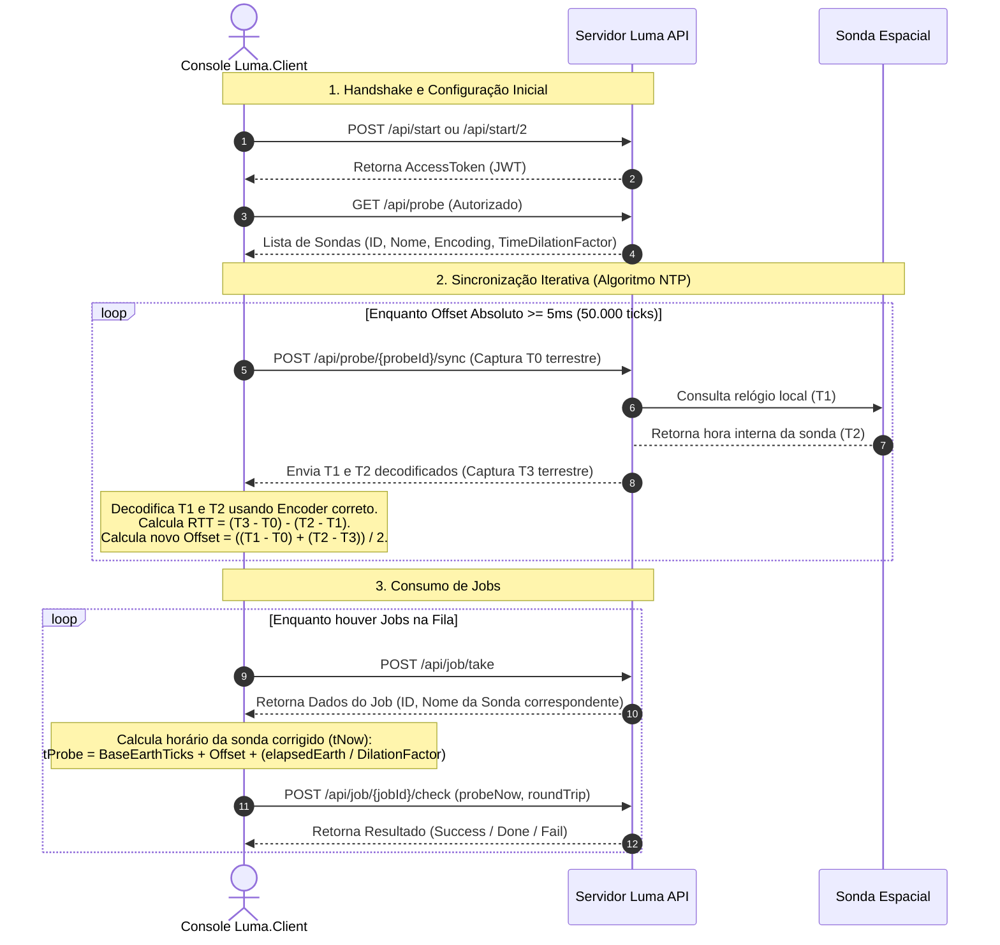

# Projeto Luma - Sincronização de Relógios Espaciais

Este repositório contém a solução cliente para o **Projeto Luma**, um sistema projetado para a sincronização de relógios de alta precisão entre a Terra e sondas espaciais que enfrentam distorções de comunicação e efeitos relativísticos, conforme detalhado no documento de admissão da Lacuna Dev (`Project Luma.html`).

---

## 🎯 Objetivos do Projeto

Com base no problema proposto em `Project Luma.html`, os objetivos principais do projeto são:

1. **Sincronização de Relógios em Ambiente Hostil:** Garantir a transferência coerente de dados no Sistema Solar através da sincronização dos relógios locais das sondas espaciais com o relógio da Terra.
2. **Precisão de Sincronização Fina:** Ajustar iterativamente o relógio de cada sonda até que o desvio temporal seja menor que **5 milissegundos** (equivalente a $50.000\text{ ticks}$).
3. **Cálculo da Latência Espacial:** Computar com precisão o tempo de ida e volta (Round-Trip Time ou RTT) dos pacotes de sinal no espaço usando uma adaptação do algoritmo de rede NTP.
4. **Validação Através de Jobs:** Consumir uma lista de tarefas (Jobs) fornecidas pela API da Lacuna, informando o horário exato ajustado de cada sonda e o último RTT correspondente.
5. **Demonstração de Boas Práticas:** Construir um programa C# .NET modularizado, legível, resiliente a falhas temporárias e que faça o reuso eficiente de componentes.

---

## 🧠 Justificativa das Regras de Negócio Aplicadas

As regras de negócio implementadas no cliente foram rigorosamente baseadas nas especificações físicas e operacionais descritas no problema proposto. A tabela a seguir explica a justificativa para cada regra aplicada:

| Regra de Negócio | Especificação no HTML | Porquê / Justificativa |
| :--- | :--- | :--- |
| **Ciclo de vida do Token (2 minutos)** | Token expira em 2 minutos; requisições retornam `Unauthorized` após isso. | **Efemeridade de Segurança:** A janela de 2 minutos para o token JWT minimiza riscos de segurança física e lógica na rede Lacuna Space. O orquestrador reinicia automaticamente o handshake para recuperar a sessão caso receba `Unauthorized`. |
| **Convergência Iterativa (< 5ms)** | Sonda é considerada sincronizada se o desvio temporal ($\theta$) for menor que 5ms ($50.000\text{ ticks}$). | **Garantia de Janelas de Transmissão:** O alinhamento abaixo de 5ms é necessário para evitar a colisão ou sobreposição de pacotes na comunicação de rádio espacial (onde os tempos de envio e recepção precisam ser ultra-precisos). |
| **Aguardar 5 segundos na falha `ProbeUnreachable` (Nível 2)** | No Nível 2, se a API de sync falhar com `ProbeUnreachable`, o cliente deve esperar 5 segundos antes de tentar de novo. | **Perturbação por Ventos Solares:** O vento solar ioniza a atmosfera e cria ruído magnético severo, interrompendo as transmissões temporariamente. Fazer requisições imediatas sobrecarregaria a infraestrutura sem sucesso; o delay de 5 segundos permite que a tempestade ou perturbação passe. |
| **Compensação de Dilatação Temporal (Nível 2)** | Ajustar o tempo decorrido com base no parâmetro `timeDilationFactor` da sonda. | **Teoria da Relatividade Geral/Restrita:** Sondas orbitando corpos de forte campo gravitacional ou viajando a velocidades elevadas experimentam a passagem do tempo mais lentamente que na Terra. Sem a divisão pelo fator ($\Delta t_{\text{sonda}} = \Delta t_{\text{Terra}} / \text{Factor}$), o tempo estimado da sonda divergiria rapidamente e falharia na validação dos Jobs. |

---

## ⚙️ Configuração Inicial Obrigatória

Antes de executar a aplicação, você deve configurar suas credenciais para conseguir se autenticar com sucesso na API da Lacuna Luma.

1. Abra o arquivo `Luma.Client/Program.cs`.
2. Localize as variáveis `username` e `email` (geralmente por volta das linhas 59 e 60):
   ```csharp
   const string username = "SEU NOME";
   const string email = "SEU EMAIL";
   ```
3. Substitua `"SEU NOME"` pelo seu nome e `"SEU EMAIL"` pelo seu e-mail pessoal.

> [!IMPORTANT]
> A API necessita dessas credenciais válidas durante a chamada de handshake `/api/start` para gerar o token JWT e criar seu contexto individual de teste.

---

## 💡 Solução Proposta

A solução foi desenvolvida em **C#** utilizando **.NET**. Trata-se de uma aplicação cliente de console altamente modular, que orquestra a lógica de sincronização conversando diretamente com a API REST da Lacuna. A arquitetura foi estruturada da seguinte maneira:

- **Abstração por Polimorfismo:** Interface comum de codificação e decodificação de timestamps (`ITimestampEncoder`) implementada para diferentes formatos de transmissão (ISO 8601, Ticks brutos, Ticks em formato binário Little-Endian e Big-Endian serializados em Base64).
- **Algoritmo NTP Adaptado:** Cálculo dinâmico de desvio temporal (Offset) e latência de rede (RTT) que converge iterativamente até que a precisão fique abaixo do limite de tolerância de 5ms.
- **Ajuste Fino de Dilatação Temporal:** Modelagem matemática contínua para atualizar o relógio local da sonda no cliente com base no tempo decorrido na Terra dividido pelo fator relativístico, garantindo precisão mesmo nos intervalos entre sincronizações.

---

## 📂 Funcionalidade de Cada Classe

A estrutura do projeto na pasta [Luma.Client](./Luma.Client) está dividida em modelos, serviços e codificadores específicos:

### Orquestrador Principal
- **[Program.cs](./Luma.Client/Program.cs):** Contém o ponto de entrada da aplicação. Orquestra o ciclo de vida completo do cliente:
  1. Efetua o handshake inicial (obtém o token de sessão).
  2. Consulta a lista de sondas espaciais ativas.
  3. Comanda a sincronização repetida de cada sonda até atingir o threshold aceitável de 5ms.
  4. Entra em loop de consumo de tarefas (Jobs), calculando o tempo da sonda ajustado no momento exato e enviando para validação até que a API retorne o código `Done`.

### Serviços
- **[TimeSyncService.cs](./Luma.Client/Services/TimeSyncService.cs):** Classe central da lógica de sincronização. Guarda o estado de cada sonda (ID, codificador específico, fator de dilatação) e implementa as equações de ajuste de offset e relatividade. Fornece a hora atualizada projetada para a sonda através do método `GetCurrentProbeTicks()`.
- **[LumaApiClient.cs](./Luma.Client/Services/LumaApiClient.cs):** Camada de infraestrutura de rede. Encapsula o uso de `HttpClient`, configura cabeçalhos de autorização JWT (`Bearer`) dinamicamente e fornece métodos assíncronos fortemente tipados para os endpoints da API Lacuna Luma.

### Codificadores (Encoders)
Cada sonda se comunica usando um protocolo de formatação de data próprio. O projeto utiliza o padrão *Factory* para retornar a implementação apropriada da interface `ITimestampEncoder`:
- **[EncoderFactory.cs](./Luma.Client/Encoders/EncoderFactory.cs):** Resolve dinamicamente a classe decodificadora correta a partir da string de identificação fornecida pela API.
- **[Iso8601Encoder.cs](./Luma.Client/Encoders/Iso8601Encoder.cs):** Manipula datas no formato padrão string ISO 8601 com informações de fuso horário (`yyyy-MM-ddTHH:mm:ss.FFFFFFFzzz`).
- **[TicksPureEncoder.cs](./Luma.Client/Encoders/TicksPureEncoder.cs):** Processa timestamps que representam a contagem bruta de Ticks (1 tick = 100 nanossegundos) em formato string numérica comum.
- **[TicksBinaryEncoder.cs](./Luma.Client/Encoders/TicksBinaryEncoder.cs):** Decodifica e codifica inteiros de 64 bits salvos como array de bytes no formato binário **Little-Endian** convertido para string Base64.
- **[TicksBinaryBigEndianEncoder.cs](./Luma.Client/Encoders/TicksBinaryBigEndianEncoder.cs):** Decodifica e codifica inteiros de 64-bits gravados como array de bytes no formato binário **Big-Endian** convertido para string Base64.

### Modelos de Dados
- **[Dtos.cs](./Luma.Client/Models/Dtos.cs):** Reúne records imutáveis que servem de contrato para envio e recepção de dados via JSON na API REST (como `StartRequest`, `ProbesResponse`, `SyncResponse`, `Job`, etc.).

---

## 🔄 Fluxo de Dados

Abaixo é apresentado o diagrama de sequência detalhando a interação entre o cliente console, o servidor da API Luma e as sondas espaciais:



---

## 🚀 Como Executar o Projeto

### Pré-requisitos
- Ter o **.NET SDK** instalado (versão 6.0 ou superior recomendada).
- Conexão ativa com a internet (para comunicação com `https://luma.lacuna.cc`).

### Passo a Passo de Execução

1. Abra o terminal e navegue até a pasta raiz onde clonou ou extraiu o projeto:
   ```bash
   cd /caminho/do/seu/diretorio/ProjetoLuma
   ```

2. Execute o projeto usando o CLI do .NET. Você pode executar em modo interativo ou passar o nível desejado diretamente por argumento:

   * **Modo Interativo (Pergunta qual nível usar):**
     ```bash
     dotnet run --project Luma.Client
     ```
     *Após rodar, selecione o nível no console: `1` para o fluxo padrão ou `2` para o fluxo avançado com dilatação temporal relativística.*

   * **Executar Nível 1 diretamente:**
     ```bash
     dotnet run --project Luma.Client level1
     ```

   * **Executar Nível 2 diretamente (Avançado - Relatividade):**
     ```bash
     dotnet run --project Luma.Client level2
     ```

3. O console exibirá as mensagens em tempo real detalhando cada passo do fluxo (autenticação, sincronização iterativa, consumo e validação de jobs). Ao final do processo, se todos os jobs forem validados corretamente, o programa exibirá a mensagem de sucesso:
   ```text
   🎉 Desafio concluído com SUCESSO!
   ```
